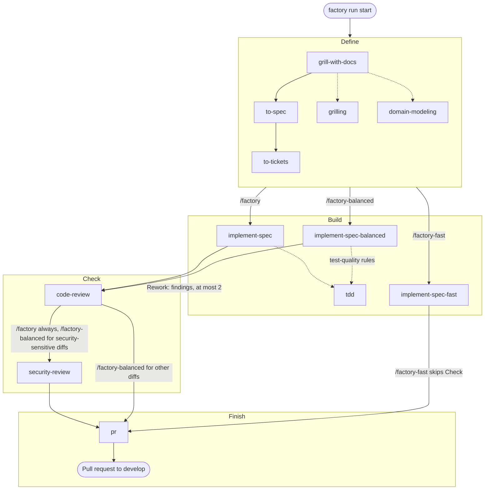

# TDS Factory

An early Rust foundation for a small software factory, inspired by the original [TDS Factory](https://github.com/TDSchreur/tds-factory). The goal is to take a piece of work from idea to delivery with a simple flow and low time and token costs.

The core flow is **define → build → check → finish**, implemented as an agent skill. Start small and add steps only when they are useful.

## Install

Prerequisites: Linux x86-64 or Windows x86-64, `git`, and a supported coding agent (Codex, Claude Code, or GitHub Copilot). The `gh` CLI is needed for the workflows to open pull requests. Building from source also needs a Rust toolchain with Cargo.

Install the latest release with one command:

Linux x86-64:

```sh
curl -fsSL https://github.com/TDSchreur/tds-factory2/releases/latest/download/install.sh | sh
```

Windows x86-64 (PowerShell):

```powershell
irm https://github.com/TDSchreur/tds-factory2/releases/latest/download/install.ps1 | iex
```

Both installers download the prebuilt CLI, verify its release checksum, ask which agents to install the TDS Factory skills for (Codex, Claude Code, GitHub Copilot, one or more), and install them. Answer with numbers or names, such as `1,3` or `claude copilot`, or `all`. To skip the prompt, set `FACTORY_AGENT` to a comma-separated list before running the installer, for example `FACTORY_AGENT=codex,claude` (`$env:FACTORY_AGENT = 'codex,claude'` in PowerShell). Without `FACTORY_AGENT` and without a terminal to ask on, the installer stops before installing anything. Each install replaces the bundled skill directories with the versions shipped in the CLI, so local edits to those skills are lost; other skills in the same folder are left alone. To install skills for other agents later, run `factory install --agent claude` (or `codex` / `copilot`, or a comma-separated list such as `codex,claude`). Re-running the one-line installer updates both the CLI and its skills.

Claude Code skills go to `$CLAUDE_CONFIG_DIR/skills` when `CLAUDE_CONFIG_DIR` is set (for example `~/.claude-work`), otherwise `~/.claude/skills`. Codex skills likewise honor `CODEX_HOME`.

Stop the dashboard before upgrading, especially on Windows where a running executable cannot be replaced. The Windows CLI cross-compiles, but the installer has not yet been run on Windows; the release workflow tests the build on a Windows runner.

To build from source instead, run:

```sh
cargo run -- --help
cargo run -- --version
cargo run -- dashboard
```

The Rocket server binds to localhost at <http://127.0.0.1:4311>; press Ctrl+C to stop it. It stores run progress under `$XDG_DATA_HOME/tds-factory/` (or `~/.local/share/tds-factory/` when unset) on Linux, and `%LOCALAPPDATA%\tds-factory\` on Windows. Keep it running while using TDS Factory. To install from a checkout, use `cargo install --path . --locked`, ensure Cargo's bin directory is on PATH, and run `factory install --agent <codex|claude|copilot>`. Restart a previously running dashboard after upgrading.

The dashboard footer and `factory --version` show which build is running: the version number, such as `0.3.1`, for an official release, and `dev <commit>`, such as `dev 1a2b3c4`, for any other build, including builds from a checkout. A build without git information, such as from a source archive, shows `dev (unknown commit)`. Official release builds set `FACTORY_RELEASE=1`.

## Use

1. Start the dashboard and keep it running in a separate terminal: `factory dashboard`. Open <http://127.0.0.1:4311> to follow your runs. The dashboard follows your system's light or dark setting; use the Theme control (System, Light, Dark) to override it. The choice is remembered in your browser.
2. In your project, ask your coding agent to run `/factory`, `/factory-balanced`, or `/factory-fast` with your task; see [Choosing a mode](#choosing-a-mode). The agent reports progress to the dashboard with `factory run start` and `factory run update`, and ends by opening a pull request and watching its CI.
3. Review the pull request. See [Skills](#skills) for what each workflow does.

### Reporting runs manually

For manual tracking, `factory run start "Task title"` prints a run ID, and `factory run update <id> build running` updates it. Stages are `define`, `build`, `check`, and `finish`; statuses are `running`, `blocked`, and `done`.

Run updates also accept optional reporting fields:

```sh
factory run update <id> build running --activity "Implementing ticket #42" --current-ticket "https://github.com/owner/repo/issues/42"
factory run update <id> build blocked --blocking-reason "Waiting for credentials"
factory run update <id> build running --clear-blocking-reason
factory run update <id> build running --rework 1 --activity "Fixing Check findings"
factory run update <id> finish done --clear-activity --clear-current-ticket
```

Omitted fields keep their stored values, including when changing stage or status. Use `--clear-activity`, `--clear-current-ticket`, `--clear-blocking-reason`, and `--clear-rework` to remove them explicitly. Setting and clearing the same field in one command, or repeating a field option, is an error. Activity and blocking reason must be nonblank and at most 2,000 bytes; a current-ticket link must be an absolute HTTP(S) URL of at most 4,096 bytes. Empty strings are rejected; use a clear flag instead. `--rework` records which [Rework](GLOSSARY.md) the run is on, as a whole number from 1 to 99; the dashboard shows it as "Rework 1 of 2", or "Rework 3 (past the cap of 2)" when the user granted an extra Rework.

The API uses `activity`, `current_ticket`, `blocking_reason`, and `rework` on `POST /api/runs/<id>` alongside the required `stage` and `status`. Omit a metadata field to preserve it, send a value (a string, or a number for `rework`) to replace it, or send JSON `null` to clear it. Unknown update fields are rejected. For example:

```json
{"stage":"build","status":"running","activity":"Implementing ticket #42","blocking_reason":null}
```

Run responses and `runs.json` include these optional fields and `updated_at`, a server-owned Unix timestamp in milliseconds set on creation and each successful update. Callers cannot set `updated_at` through an update. Existing records load with `null` for missing metadata and timestamps; they receive a timestamp on their next update. The timestamp records a run update, not an agent heartbeat. Restart the dashboard with the updated CLI before using the new options. The dashboard shows these fields on each run card.

The server listens only on localhost but has no user authentication. Other users on the same machine can read and change run titles and project paths; use it only on a trusted machine.

## Skills

The workflow skills [`factory`](.agents/skills/factory/SKILL.md), [`factory-balanced`](.agents/skills/factory-balanced/SKILL.md), and [`factory-fast`](.agents/skills/factory-fast/SKILL.md) coordinate the flow using skills from [mattpocock/skills](https://github.com/mattpocock/skills) and [github/awesome-copilot](https://github.com/github/awesome-copilot). After installing the skills, ask your coding agent to run one of them on your task. See [skills/README.md](skills/README.md) for the upstream origins.

### Workflow modes

TDS Factory has three workflow modes that trade speed against rigor: `/factory` favors quality, `/factory-fast` favors speed, and `/factory-balanced` sits between them. All three report progress to the dashboard and end with the same Finish stage; `/factory-fast` skips Check. Each run starts by creating a fresh git worktree from `origin/<base branch>` next to the repository and does all its work there, so several runs can proceed at once; the original checkout is never touched, and the worktree is kept after the pull request opens until you remove it with `git worktree remove`.

| Stage | `/factory` (quality) | `/factory-balanced` | `/factory-fast` (speed) |
| --- | --- | --- | --- |
| Define | Always grills with [`grill-with-docs`](skills/grill-with-docs/SKILL.md) (`grilling`, `domain-modeling`), writes a spec with [`to-spec`](skills/to-spec/SKILL.md), and breaks it into tickets with [`to-tickets`](skills/to-tickets/SKILL.md) | Uses a clear request as the spec, otherwise one `to-spec` pass without grilling; always writes explicit acceptance criteria; `to-tickets` only for multi-piece work; `grill-with-docs` only when ambiguity blocks implementation | Uses a clear request as the spec with a short plan and acceptance criteria; `grill-with-docs`, `to-spec`, and `to-tickets` only when needed |
| Build | [`implement-spec`](skills/implement-spec/SKILL.md), test-first with `tdd` red-green cycles | [`implement-spec-balanced`](skills/implement-spec-balanced/SKILL.md): implements each ticket, then adds behavior tests through public interfaces using `tdd`'s test-quality rules, without red-green cycles or seam approval | [`implement-spec-fast`](skills/implement-spec-fast/SKILL.md): implements directly; tests only where useful |
| Check | [`code-review`](skills/code-review/SKILL.md), then [`security-review`](skills/security-review/SKILL.md); findings go back to Build for a Rework, then both reviews run again | One `code-review` pass; `security-review` only when the diff touches input parsing, auth or secrets, network, file or process handling, or dependencies; findings go back to Build for a Rework, then one review pass covers the fixes | Skipped |
| Finish | [`pr`](skills/pr/SKILL.md) writes the description and opens a pull request, then the agent watches its CI and fixes failures | Same | Same |

All modes build sequentially in one worktree without subagents and run the project's checks before moving on.

In `/factory` and `/factory-balanced`, actionable Check findings send the run back to Build for a **Rework** with that mode's build approach, then Check runs again. A run gets at most two Reworks, and the dashboard shows the current one as "Rework 1 of 2". Check findings never block a run: when findings remain after the second Rework, or one cannot be resolved, the agent lists them and asks you whether to do one more Rework, finish with the findings listed in the pull request, or stop. `/factory-fast` has no Check and so no Rework.

### Choosing a mode

- **`/factory`**: risky, complex, or poorly understood work where you want every requirement questioned and every behavior built test-first. Slowest and most token-intensive.
- **`/factory-balanced`**: everyday features and fixes that deserve tests and a review but not a full interview or red-green cycles.
- **`/factory-fast`**: small, clear, low-risk changes such as documentation, configuration, or obvious fixes. No review stage.

When unsure, start with `/factory-balanced`.

The diagram shows the skills each mode runs. Arrows between stages are labeled with the mode that takes them; `/factory-balanced` and `/factory-fast` run each Define skill only in the cases the table lists. Dotted lines show skills that another skill loads or applies, and the Rework loop from Check back to Build.



`factory install` also installs `codebase-design` and `triage`, which no workflow calls directly, and `setup-matt-pocock-skills`, which you run yourself (see below).

### First use in a repository

Run `/setup-matt-pocock-skills` once in each repository before the first workflow run. It records the repository's issue tracker, triage labels and domain-doc layout in `docs/agents/` and adds an `## Agent skills` section to `AGENTS.md` or `CLAUDE.md`. Run it in your normal checkout; there is no need to commit it or push it to a protected branch first. Each workflow run starts in a fresh worktree and carries the uncommitted setup output over from the checkout it was started in, so the output lands in that run's pull request. The workflows stop at the start of Define when `docs/agents/issue-tracker.md` exists neither in the worktree nor in the original checkout.

The [Rust skill](skills/rust/SKILL.md) and [project instructions](AGENTS.md) guide Rust development in this repository.

## Development

Day-to-day work targets `develop`; releases merge `develop` into `master`. See [the release guide](docs/releasing.md) for the release and branch-protection setup.

Run `scripts/verify.sh` before finishing a change and opening a pull request. It runs the same checks as CI, in the same order, and stops at the first failure; it needs `cargo`, `rustfmt` and `clippy` (`rustup component add rustfmt clippy`). The individual commands are:

```sh
cargo fmt --check
cargo clippy --all-targets --locked -- -D warnings
cargo test --locked
```
