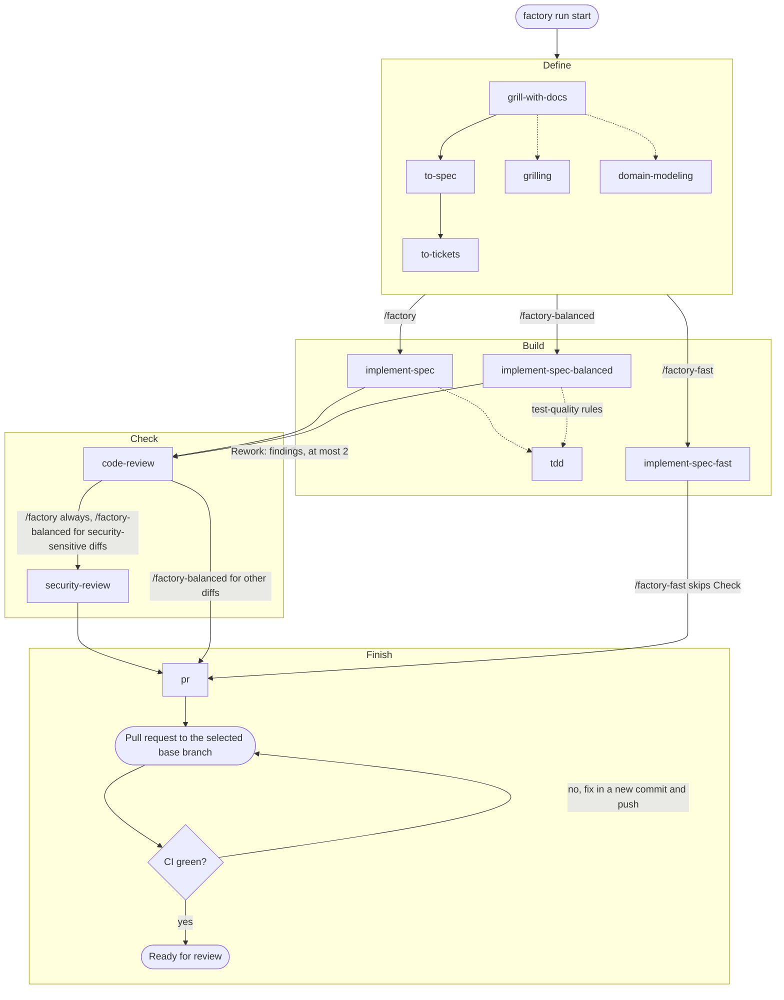

# TDS Factory

An early Rust foundation for a small software factory, inspired by the original [TDS Factory](https://github.com/TDSchreur/tds-factory). The goal is to take a piece of work from idea to delivery with a simple flow and low time and token costs.

The core flow is **define → build → check → finish**, implemented as an agent skill. Start small and add steps only when they are useful.

## Install

Prerequisites: Linux x86-64 or Windows x86-64, `git`, and a supported coding agent (Codex, Claude Code, or GitHub Copilot). The `gh` CLI is needed for the workflows to open pull requests. Building from source also needs a Rust toolchain with Cargo.

Install the latest release with one command:

Linux x86-64:

```sh
curl -fsSL https://github.com/TDSchreur/tds-factory2/releases/latest/download/install.sh | sh
```

Windows x86-64 (PowerShell):

```powershell
irm https://github.com/TDSchreur/tds-factory2/releases/latest/download/install.ps1 | iex
```

Both installers download the prebuilt CLI, verify its release checksum, ask which agents to install the TDS Factory skills for (Codex, Claude Code, GitHub Copilot, one or more), and install them. Answer with numbers or names, such as `1,3` or `claude copilot`, or `all`. To skip the prompt, set `FACTORY_AGENT` to a comma-separated list before running the installer, for example `FACTORY_AGENT=codex,claude` (`$env:FACTORY_AGENT = 'codex,claude'` in PowerShell). Without `FACTORY_AGENT` and without a terminal to ask on, the installer stops before installing anything. Each install replaces the bundled skill directories with the versions shipped in the CLI, so local edits to those skills are lost; other skills in the same folder are left alone. To install skills for other agents later, run `factory install --agent claude` (or `codex` / `copilot`, or a comma-separated list such as `codex,claude`). Re-running the one-line installer updates both the CLI and its skills.

To see whether a newer release exists, run `factory check`. It looks up the latest release with `curl`, says whether you are up to date, and exits 0 either way (1 on an error, such as no network). A development build cannot be compared, so it only names the latest release.

Claude Code skills go to `$CLAUDE_CONFIG_DIR/skills` when `CLAUDE_CONFIG_DIR` is set (for example `~/.claude-work`), otherwise `~/.claude/skills`. Codex skills likewise honor `CODEX_HOME`.

Stop the dashboard before upgrading, especially on Windows where a running executable cannot be replaced. The Windows CLI cross-compiles, but the installer has not yet been run on Windows; the release workflow tests the build on a Windows runner.

To build from source instead, run:

```sh
cargo run -- --help
cargo run -- --version
cargo run -- dashboard
```

The Rocket server binds to localhost at <http://127.0.0.1:4311>; press Ctrl+C to stop it. It stores run progress under `$XDG_DATA_HOME/tds-factory/` (or `~/.local/share/tds-factory/` when unset) on Linux, and `%LOCALAPPDATA%\tds-factory\` on Windows. Keep it running while using TDS Factory. After a merge, `scripts/update-local.sh` updates the checkout and prompts for one or more agents; set `FACTORY_AGENT=codex,claude` to select them without a prompt. To install from a checkout, use `cargo install --path . --locked`, ensure Cargo's bin directory is on PATH, and run `factory install --agent <codex|claude|copilot>`. Restart a previously running dashboard after upgrading.

One dashboard serves every Project. Running `factory dashboard` while one is already running prints its URL (opening on the current Project) and exits, and warns when that dashboard is a different build; it never stops it. Use `factory dashboard --port <port>` for a separate dashboard on another port with its own `runs-<port>.json`; `factory run` reports to the default port only.

The dashboard page is plain files in `dashboard/` (`index.html`, `app.js`, `style.css`), built with Preact and htm, committed in `dashboard/vendor/` and loaded through an import map, so there is no build step and no `npm install`. The server embeds the files in the binary and serves only the ones it lists under `/assets/`. When you add a file the page loads, add it to the list in `src/server.rs`. See [`dashboard/vendor/README.md`](dashboard/vendor/README.md) for the library versions; their licenses are in `third-party/`.

The dashboard footer and `factory --version` show which build is running: the version number, such as `0.3.1`, for an official release, and `dev <commit>`, such as `dev 1a2b3c4`, for any other build, including builds from a checkout. A build without git information, such as from a source archive, shows `dev (unknown commit)`. Official release builds set `FACTORY_RELEASE=1`.

## Use

1. Start the dashboard and keep it running in a separate terminal: `factory dashboard`. Open <http://127.0.0.1:4311> to follow your runs. The dashboard follows your system's light or dark setting; use the Theme control (System, Light, Dark) to override it. The choice is remembered in your browser.
2. In your project, ask your coding agent to run `/factory`, `/factory-balanced`, or `/factory-fast` with your task; see [Choosing a mode](#choosing-a-mode). The agent reports progress to the dashboard with `factory run start` and `factory run update`, and ends by opening a pull request and watching its CI.
3. Review the pull request. See [Skills](#skills) for what each workflow does.

### Reporting runs manually

For manual tracking, `factory run start "Task title"` prints a run ID, and `factory run update <id> build running` updates it. Stages are `define`, `build`, `check`, and `finish`; statuses are `running`, `blocked`, and `done`.

#### Run context

Besides its stage and status, a run records the context a new session needs to continue it. It is recorded only through `factory run update`, never by editing the storage file, and holds references and short summaries, not transcripts or secrets:

| Option | Records |
| --- | --- |
| `factory run start` | The canonical `repository` (the main checkout, the same from every linked worktree) next to the folder the run started in. |
| `--worktree <absolute-path>`, `--branch <name>`, `--base-commit <sha>` | Where the run's work lives and the commit it started from. |
| `--mode <factory\|factory-balanced\|factory-fast>` | The workflow mode. |
| `--spec <http(s)-url\|path>`, `--pr <http(s)-url>` | The spec (a URL or a local path) and the pull request. URLs with credentials are refused. |
| `--ticket "<reference> <title>"` (repeat), `--ticket-status <reference>=<pending\|in-progress\|done>` | The ordered ticket list, listed whole each time (statuses of kept tickets are preserved), and its progress. At most one ticket is in progress. |
| `--summary <stage>=<text>` | A short summary per stage, kept after later stages begin. |
| `--blocking-reason <text>` | The status reason of a blocked run. |

Options left out keep their value, each has a `--clear-*` form (`--clear-tickets`, `--clear-summary <stage>`), and an inconsistent update is refused with the reason and changes nothing. A run recorded before this existed shows its missing context as unknown.

`factory run inspect <id>` prints a run's context (`--json` for the stored record). The dashboard shows it in the run's detail, shows ticket progress and pull request and spec links on cards, and groups the runs of every linked worktree under their repository.

To continue a run in a new session, ask the agent to continue it by ID. The workflow skills then read the context and check the recorded repository, worktree, branch, base commit and Git state, report any difference, and never reset, clean or discard work to make them match.

Run updates also accept optional reporting fields:

```sh
factory run update <id> build running --activity "Implementing ticket #42" --current-ticket "https://github.com/owner/repo/issues/42"
factory run update <id> build blocked --blocking-reason "Waiting for credentials"
factory run update <id> build running --clear-blocking-reason
factory run update <id> build running --rework 1 --activity "Fixing Check findings"
factory run update <id> finish done --clear-activity --clear-current-ticket
```

Omitted fields keep their stored values, including when changing stage or status. Use `--clear-activity`, `--clear-current-ticket`, `--clear-blocking-reason`, and `--clear-rework` to remove them explicitly. Setting and clearing the same field in one command, or repeating a field option, is an error. Activity and blocking reason must be nonblank and at most 2,000 bytes; a current-ticket link must be an absolute HTTP(S) URL of at most 4,096 bytes. Empty strings are rejected; use a clear flag instead. `--rework` records which [Rework](GLOSSARY.md) the run is on, as a whole number from 1 to 99; the dashboard shows it as "Rework 1 of 2", or "Rework 3 (past the cap of 2)" when the user granted an extra Rework.

The API uses `activity`, `current_ticket`, `blocking_reason`, and `rework` on `POST /api/runs/<id>` alongside the required `stage` and `status`. Omit a metadata field to preserve it, send a value (a string, or a number for `rework`) to replace it, or send JSON `null` to clear it. Unknown update fields are rejected. For example:

```json
{"stage":"build","status":"running","activity":"Implementing ticket #42","blocking_reason":null}
```

Run responses and `runs.json` include these optional fields and `updated_at`, a server-owned Unix timestamp in milliseconds set on creation and each successful update. Callers cannot set `updated_at` through an update. Existing records load with `null` for missing metadata and timestamps; they receive a timestamp on their next update. The timestamp records a run update, not an agent heartbeat. Restart the dashboard with the updated CLI before using the new options. The dashboard shows these fields on each run card. Done runs show on one line with a Show details toggle, and can be deleted one by one or all at once after a confirmation; deleting removes only the run record, not its worktree or pull request. The record is removed by `DELETE /api/runs/<id>`, which needs the session token from the dashboard page (sent as `X-Session-Token`), so it works from the dashboard only.

The server listens only on localhost but has no user authentication. Other users on the same machine can read and change run titles and project paths; use it only on a trusted machine.

## Skills

The workflow skills [`factory`](.agents/skills/factory/SKILL.md), [`factory-balanced`](.agents/skills/factory-balanced/SKILL.md), and [`factory-fast`](.agents/skills/factory-fast/SKILL.md) coordinate the flow using skills from [mattpocock/skills](https://github.com/mattpocock/skills) and [github/awesome-copilot](https://github.com/github/awesome-copilot), plus [blader/humanizer](https://github.com/blader/humanizer), which edits the prose they write. After installing the skills, ask your coding agent to run one of them on your task. See [skills/README.md](skills/README.md) for the upstream origins.

### Workflow modes

TDS Factory has three workflow modes that trade speed against rigor: `/factory` favors quality, `/factory-fast` favors speed, and `/factory-balanced` sits between them. All three report progress to the dashboard and end with the same Finish stage; `/factory-fast` skips Check. Each run uses its own fresh git worktree based on `origin/<base branch>`, so several runs can proceed at once. Start the run in a fresh, dedicated worktree if your agent environment provides one, or the workflow creates one next to the repository. The original checkout is not modified, and the worktree is kept after the pull request opens until you remove it with `git worktree remove`.

| Stage | `/factory` (quality) | `/factory-balanced` | `/factory-fast` (speed) |
| --- | --- | --- | --- |
| Define | Always grills with [`grill-with-docs`](skills/grill-with-docs/SKILL.md) (`grilling`, `domain-modeling`), writes a spec with [`to-spec`](skills/to-spec/SKILL.md), and breaks it into tickets with [`to-tickets`](skills/to-tickets/SKILL.md) | Uses a clear request as the spec, otherwise one `to-spec` pass without grilling (tracker setup only when it reads or publishes tracker specs or tickets); always writes explicit acceptance criteria; `to-tickets` only for multi-piece work; `grill-with-docs` only when ambiguity blocks implementation | Uses a clear request as the spec with a short plan and acceptance criteria, no tracker setup for a clear request; `grill-with-docs`, `to-spec`, and `to-tickets` only when needed |
| Build | [`implement-spec`](skills/implement-spec/SKILL.md), test-first with `tdd` red-green cycles | [`implement-spec-balanced`](skills/implement-spec-balanced/SKILL.md): implements each ticket, then adds behavior tests through public interfaces using `tdd`'s test-quality rules, without red-green cycles or seam approval | [`implement-spec-fast`](skills/implement-spec-fast/SKILL.md): implements directly; tests only where useful |
| Check | [`code-review`](skills/code-review/SKILL.md), then [`security-review`](skills/security-review/SKILL.md); findings go back to Build for a Rework, then both reviews run again over the fixes | One initial `code-review`, with follow-up reviews of the Rework fixes; `security-review` only when the diff touches input parsing, auth or secrets, network, file or process handling, or dependencies; findings go back to Build for a Rework | Skipped |
| Finish | [`pr`](skills/pr/SKILL.md) writes the description and opens a pull request against the selected base branch, then the agent watches its CI and fixes failures with new commits until it is green | Same | Same |

`/factory-fast` saves time through lighter planning, selective test writing and no Check stage, but it still runs the project's verification and waits for green CI before it reports the pull request ready. All modes build sequentially in one worktree without subagents and run the project's relevant checks as they go. Full verification, meaning every command the project requires before merging, runs after each ticket in `/factory`, but once on the finished candidate in `/factory-balanced` and `/factory-fast`; `/factory` and `/factory-balanced` also rerun it after a Rework. Finish verifies the final commit, reusing the latest passing full verification when nothing has changed since it ran. Stricter project-required checks always apply. The three workflows share their run reporting, continuation, workspace, tracker setup, writing and pull request procedures in the installed `factory-procedures` skill, which they read before starting; each workflow keeps its own planning, testing, review and verification rules. Prose for people, such as specs, tickets, summaries and pull request descriptions, goes through the bundled `humanizer` skill, which leaves facts, evidence, required sections and technical content as they are.

For Codex, start a new chat in Worktree mode on the intended base branch and tell the factory to use that fresh worktree. The workflow verifies it is clean and matches the fetched remote base before creating the feature branch. Codex-managed worktrees may have their own lifecycle; retain the worktree while review follow-ups are needed. Depending on the sandbox, Git operations that write shared repository metadata, network access for fetch and GitHub, and dashboard access may still require permission. In other environments, configure the sibling worktree location as writable before starting the session if needed; that alone may not grant access to shared Git metadata.

In `/factory` and `/factory-balanced`, the agent commits the finished implementation before Check, because `code-review` only sees committed changes; it reviews everything since the run's base commit. Actionable Check findings send the run back to Build for a **Rework** with that mode's build approach; the fixes, including new files, are committed, and Check runs again over the commits since the previously reviewed one. A run gets at most two Reworks, and the dashboard shows the current one as "Rework 1 of 2". Findings alone never block a run, and the agent fixes them within the two Reworks. When findings remain after the second Rework, or one cannot be resolved, the run shows as blocked while the agent lists them and asks you whether to do one more Rework, finish with the findings listed in the pull request, or stop; the block clears when work resumes. `/factory-fast` has no Check and so no Rework.

### Choosing a mode

- **`/factory`**: risky, complex, or poorly understood work where you want every requirement questioned and every behavior built test-first. Slowest and most token-intensive.
- **`/factory-balanced`**: everyday features and fixes that deserve tests and a review but not a full interview or red-green cycles.
- **`/factory-fast`**: small, clear, low-risk changes such as documentation, configuration, or obvious fixes. No review stage.

When unsure, start with `/factory-balanced`.

The diagram shows the skills each mode runs, through Finish and the CI watch. Arrows between stages are labeled with the mode that takes them; `/factory-balanced` and `/factory-fast` run each Define skill only in the cases the table lists. Dotted lines show skills that another skill loads or applies, and the Rework loop from Check back to Build.



`factory install` also installs `codebase-design` and `triage`, which no workflow calls directly, and `setup-matt-pocock-skills`, which you run yourself (see below).

#### Token usage

The dashboard reads the token counts your agents write to their own session logs and shows them per run, stage, model and ticket. It counts tokens only, never money, and it keeps only counts and identifiers: no conversation text, prompts, tool output or credentials are stored.

- `factory run stats <id>` prints the breakdown (stage, model and ticket, with the rework and work with no ticket in their own rows), the totals per model, and what the figures do not cover. `factory run stats --all` adds the totals per model over all runs and names the runs it leaves out.
- The dashboard shows the fresh tokens on a card and the breakdown in the run's detail.

**What the figures mean.** Every agent is normalized to the same four counts:

| Count | Meaning |
| --- | --- |
| Input | Input tokens that were not read from the cache. |
| Cache read | Input served from the cache. |
| Cache write | Tokens written to the cache. |
| Output | Output tokens, including reasoning tokens where the agent counts them in output. |

**Fresh tokens** are the headline figure: input excluding cache reads, plus cache writes and output. Cache reads are shown beside them, not inside, so large cached contexts do not hide the work. Reasoning is shown as "of which" and is never added to output twice. Codex and Copilot report cached tokens inside their input; the dashboard takes them out so all agents compare. A count an agent does not report is `n/a`, never zero.

**How a session is tied to a run.** Folder and time are never enough on their own. A session counts for a run when its id was recorded on the run, or its log holds a `factory run update`, `inspect` or `stats` command naming the run's id (the id elsewhere in a log, such as in a listing, does not count). `factory run start` and `factory run update` record Claude Code's session id automatically; for another agent, pass `--session <id>` when you know it. Within a session, each log entry goes to the stage, rework and ticket the run was in at that moment (the run keeps a small timeline of when those changed). Work that spans two runs at the same moment in one session is not divided by guessing: it is reported as not assigned. Subagent usage is included once, in the stage and model it ran under, and shown as a separate share.

**Coverage.** Usage is `tracked`, `partial` (with the reasons, such as a malformed or unreadable log, a stage with no data, or work not assigned) or `not tracked` (with the reason, such as no log naming the run, or a run from before usage tracking). Stored counts are kept when a vendor later deletes its logs.

**When it is collected.** By the dashboard, in the background, when a run changes stage, rework, ticket or session and when it finishes, and again about 15 and 60 seconds later, because agents write their logs a little after the work. It recomputes the whole run, so reading twice never counts twice, and a failure never delays or stops a run. Reading is bounded in time, in the number and size of the logs, and it does not follow links out of the log folders. There is no periodic reporting and no extra service.

**Opt out** with `factory dashboard --no-usage`, or by starting the dashboard with `FACTORY_USAGE=off`. Runs without counts then show `not tracked` and say why; counts already collected are kept.

**What has been validated.** Claude Code and Codex logs were inspected on a real machine, and all three formats are covered by fixture tests that need no agent installed. Copilot's `session.usage_record` events could not be checked against real logs (the local sessions held none), so Copilot support is fixture-tested only. Codex's `cache_write_input_tokens` was zero in every sample, so whether it is part of Codex's input is unvalidated; it is treated as included, like Copilot's. Agent log formats are not a stable interface: if one changes, the affected logs show as `partial` or `not tracked` instead of wrong numbers.

### Checking readiness

`factory doctor` reports whether the current repository and your machine are ready for the factory, without changing anything, installing anything or starting the dashboard. It checks:

- the project: a Git repository, an `origin` remote, origin's default branch (`git remote set-head origin --auto` sets it when unknown), the setup output of `/setup-matt-pocock-skills` (`docs/agents/issue-tracker.md` and the `## Agent skills` section), which `/factory` always needs and the lighter workflows only when they read or publish specs or tickets, and the verification commands listed as bullets under `## Commands` in `AGENTS.md` or `CLAUDE.md`. It looks for each command's tool but never runs it.
- each agent (Codex, Claude Code, Copilot): its command is on `PATH`, and every file of every skill `factory install` bundles is installed in the folder `factory install` would use (honoring `CODEX_HOME` and `CLAUDE_CONFIG_DIR`).

Each line is `pass`, `missing` (something to supply) or `fail` (something broken), with a fix. The exit status is 0 when the project checks pass and at least one agent is usable. Use `--agent codex|claude|copilot` to check, and require, one agent, and `--json` for structured output.

### First use in a repository

Run `/setup-matt-pocock-skills` once in each repository before the first workflow run. It records the repository's issue tracker, triage labels and domain-doc layout in `docs/agents/` and adds an `## Agent skills` section to `AGENTS.md` or `CLAUDE.md`. Run it in your normal checkout; there is no need to commit it or push it to a protected branch first. Each workflow run starts in a fresh worktree and carries the uncommitted setup output over from the checkout it was started in, so the output lands in that run's pull request. `/factory` stops at the start of Define when `docs/agents/issue-tracker.md` exists neither in the worktree nor in the original checkout. `/factory-balanced` and `/factory-fast` need it only when a run reads or publishes a spec or tickets in the tracker; a clear, bounded request planned in the conversation runs without it. A run whose plan exists only in the conversation saves its plan and acceptance criteria in a file outside the pull request (in the worktree's git directory, or beside the worktree) and records it with `--spec`, so another session can continue from `factory run inspect` without the original chat.

The [Rust skill](skills/rust/SKILL.md) and [project instructions](AGENTS.md) guide Rust development in this repository.

## Development

Day-to-day work targets `develop`; releases merge `develop` into `master`. See [the release guide](docs/releasing.md) for the release and branch-protection setup.

Run `scripts/verify.sh` before finishing a change and opening a pull request. It runs the same checks as CI, in the same order, and stops at the first failure; it needs `cargo`, `rustfmt` and `clippy` (`rustup component add rustfmt clippy`). The individual commands are:

```sh
cargo fmt --check
cargo clippy --all-targets --locked -- -D warnings
cargo test --locked
```
