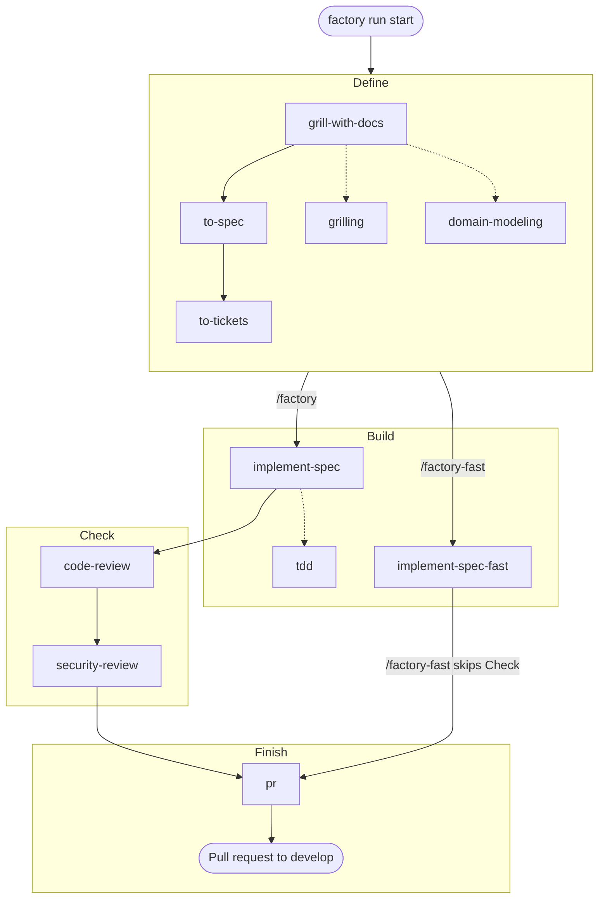

# TDS Factory

An early Rust foundation for a small software factory, inspired by the original [TDS Factory](https://github.com/TDSchreur/tds-factory). The goal is to take a piece of work from idea to delivery with a simple flow and low time and token costs.

The core flow is **define → build → check → finish**, implemented as an agent skill. Start small and add steps only when they are useful.

## Install

Prerequisites: Linux x86-64 or Windows x86-64, `git`, and a supported coding agent (Codex, Claude Code, or GitHub Copilot). The `gh` CLI is needed for the workflows to open pull requests. Building from source also needs a Rust toolchain with Cargo.

Install the latest release with one command:

Linux x86-64:

```sh
curl -fsSL https://github.com/TDSchreur/tds-factory2/releases/latest/download/install.sh | sh
```

Windows x86-64 (PowerShell):

```powershell
irm https://github.com/TDSchreur/tds-factory2/releases/latest/download/install.ps1 | iex
```

Both installers download the prebuilt CLI, verify its release checksum, and install the TDS Factory skills for Codex. Set `FACTORY_AGENT` to `claude` or `copilot` before running the installer to choose another agent. Each install replaces the bundled skill directories with the versions shipped in the CLI, so local edits to those skills are lost; other skills in the same folder are left alone. To install skills for another agent later, run `factory install --agent claude` (or `codex` / `copilot`). Re-running the one-line installer updates both the CLI and its skills.

Claude Code skills go to `$CLAUDE_CONFIG_DIR/skills` when `CLAUDE_CONFIG_DIR` is set (for example `~/.claude-work`), otherwise `~/.claude/skills`. Codex skills likewise honor `CODEX_HOME`.

Stop the dashboard before upgrading, especially on Windows where a running executable cannot be replaced. The Windows CLI cross-compiles, but the installer has not yet been run on Windows; the release workflow tests the build on a Windows runner.

To build from source instead, run:

```sh
cargo run -- --help
cargo run -- --version
cargo run -- dashboard
```

The Rocket server binds to localhost at <http://127.0.0.1:4311>; press Ctrl+C to stop it. It stores run progress under `$XDG_DATA_HOME/tds-factory/` (or `~/.local/share/tds-factory/` when unset) on Linux, and `%LOCALAPPDATA%\tds-factory\` on Windows. Keep it running while using TDS Factory. To install from a checkout, use `cargo install --path . --locked`, ensure Cargo's bin directory is on PATH, and run `factory install --agent codex`. Restart a previously running dashboard after upgrading.

## Use

1. Start the dashboard and keep it running in a separate terminal: `factory dashboard`. Open <http://127.0.0.1:4311> to follow your runs.
2. In your project, ask your coding agent to run `/factory` (or `/factory-fast` for small, clear requests) with your task. The agent reports progress to the dashboard with `factory run start` and `factory run update`, and ends by opening a pull request.
3. Review the pull request. See [Skills](#skills) for what each workflow does.

### Reporting runs manually

For manual tracking, `factory run start "Task title"` prints a run ID, and `factory run update <id> build running` updates it. Stages are `define`, `build`, `check`, and `finish`; statuses are `running`, `blocked`, and `done`.

Run updates also accept optional reporting fields:

```sh
factory run update <id> build running --activity "Implementing ticket #42" --current-ticket "https://github.com/owner/repo/issues/42"
factory run update <id> build blocked --blocking-reason "Waiting for credentials"
factory run update <id> build running --clear-blocking-reason
factory run update <id> finish done --clear-activity --clear-current-ticket
```

Omitted fields keep their stored values, including when changing stage or status. Use `--clear-activity`, `--clear-current-ticket`, and `--clear-blocking-reason` to remove them explicitly. Setting and clearing the same field in one command, or repeating a field option, is an error. Activity and blocking reason must be nonblank and at most 2,000 bytes; a current-ticket link must be an absolute HTTP(S) URL of at most 4,096 bytes. Empty strings are rejected; use a clear flag instead.

The API uses `activity`, `current_ticket`, and `blocking_reason` on `POST /api/runs/<id>` alongside the required `stage` and `status`. Omit a metadata field to preserve it, send a string to replace it, or send JSON `null` to clear it. Unknown update fields are rejected. For example:

```json
{"stage":"build","status":"running","activity":"Implementing ticket #42","blocking_reason":null}
```

Run responses and `runs.json` include these optional fields and `updated_at`, a server-owned Unix timestamp in milliseconds set on creation and each successful update. Callers cannot set `updated_at` through an update. Existing records load with `null` for missing metadata and timestamps; they receive a timestamp on their next update. The timestamp records a run update, not an agent heartbeat. Restart the dashboard with the updated CLI before using the new options. This step exposes reporting data through the API; the dashboard UI is unchanged.

The server listens only on localhost but has no user authentication. Other users on the same machine can read and change run titles and project paths; use it only on a trusted machine.

## Skills

The [`factory` skill](.agents/skills/factory/SKILL.md) coordinates the flow using skills from [mattpocock/skills](https://github.com/mattpocock/skills) and [github/awesome-copilot](https://github.com/github/awesome-copilot). After installing the skills, ask your coding agent to run `/factory` on your task. See [skills/README.md](skills/README.md) for the upstream origins.

Both workflows report progress to the dashboard. The diagram shows the skills each workflow runs; `/factory-fast` uses the Define skills only when a request needs them. Dotted lines show skills that `grill-with-docs` and `implement-spec` load. Each run starts by creating a fresh git worktree from `origin/<base branch>` next to the repository and does all its work there, so several runs can proceed at once; the original checkout is never touched, and the worktree is kept after the pull request opens until you remove it with `git worktree remove`.



The table lists the same skills by stage; the skills in parentheses are loaded by the skill before them.

| Stage | `/factory` | `/factory-fast` |
| --- | --- | --- |
| Define | [`grill-with-docs`](skills/grill-with-docs/SKILL.md) (`grilling`, `domain-modeling`), [`to-spec`](skills/to-spec/SKILL.md), [`to-tickets`](skills/to-tickets/SKILL.md) | The request itself as the spec for clear requests; `grill-with-docs`, `to-spec` and `to-tickets` only when needed |
| Build | [`implement-spec`](skills/implement-spec/SKILL.md) (`tdd`), sequentially without subagents | [`implement-spec-fast`](skills/implement-spec-fast/SKILL.md) |
| Check | [`code-review`](skills/code-review/SKILL.md), then [`security-review`](skills/security-review/SKILL.md) | None |
| Finish | [`pr`](skills/pr/SKILL.md) to write the pull request | `pr` |

`factory install` also installs `codebase-design`, `triage` and `rust-best-practices`, which neither workflow calls directly.

The [Rust skill](skills/rust/SKILL.md) and [project instructions](AGENTS.md) guide Rust development in this repository.

## Development

Day-to-day work targets `develop`; releases merge `develop` into `master`. See [the release guide](docs/releasing.md) for the release and branch-protection setup.

```sh
cargo fmt --check
cargo clippy --all-targets -- -D warnings
cargo test
```
