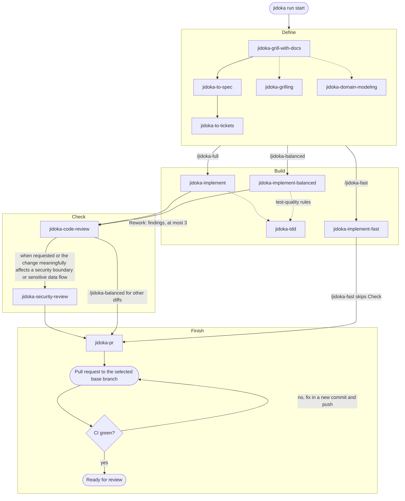

# Workflows and skills

What each workflow mode does, which skills it runs, and how to prepare a repository.

The workflow skills [`jidoka-full`](../.agents/skills/jidoka-full/SKILL.md), [`jidoka-balanced`](../.agents/skills/jidoka-balanced/SKILL.md), and [`jidoka-fast`](../.agents/skills/jidoka-fast/SKILL.md) coordinate the flow using skills from [mattpocock/skills](https://github.com/mattpocock/skills) and [github/awesome-copilot](https://github.com/github/awesome-copilot). After installing the skills, ask your coding agent to run one of them on your task. See [skills/README.md](../skills/README.md) for the upstream origins.

## First use in a repository

Run `/jidoka-setup` once in each repository before the first workflow run. It records the repository's issue tracker (GitHub, Azure Boards, or local Markdown files), triage labels and domain-doc layout in `docs/agents/` and adds an `## Agent skills` section to `AGENTS.md` or `CLAUDE.md`. Run it in your normal checkout; there is no need to commit it or push it to a protected branch first. Each workflow run starts in a fresh worktree and carries the uncommitted setup output over from the checkout it was started in, so the output lands in that run's pull request. `/jidoka-full` stops at the start of Define when `docs/agents/issue-tracker.md` exists neither in the worktree nor in the original checkout. `/jidoka-balanced` and `/jidoka-fast` need it only when a run reads or publishes a spec or tickets in the tracker; a clear, bounded request planned in the conversation runs without it. A run whose plan exists only in the conversation saves its plan and acceptance criteria in the file `jidoka run begin` and `jidoka run inspect` show as the plan path (in the Jidoka data folder, so it outlives the worktree) and records it with `--spec`, so another session can continue from `jidoka run inspect` without the original chat.

## Workflow modes

Jidoka has three workflow modes that trade speed against rigor: `/jidoka-full` favors quality, `/jidoka-fast` favors speed, and `/jidoka-balanced` sits between them. All three report progress to the dashboard and end with the same Finish stage; `/jidoka-fast` skips Check. Each run uses its own fresh git worktree based on `origin/<base branch>`, so several runs can proceed at once. Start the run in a fresh, dedicated worktree if your agent environment provides one, or the workflow creates one next to the repository. The original checkout is not modified, and the worktree is kept after the pull request opens until the pull request merges and you remove it with `jidoka run cleanup`.

| Stage | `/jidoka-full` (quality) | `/jidoka-balanced` | `/jidoka-fast` (speed) |
| --- | --- | --- | --- |
| Define | Always grills with [`jidoka-grill-with-docs`](../skills/jidoka-grill-with-docs/SKILL.md) (`jidoka-grilling`, `jidoka-domain-modeling`), writes a spec with [`jidoka-to-spec`](../skills/jidoka-to-spec/SKILL.md), and breaks it into tickets with [`jidoka-to-tickets`](../skills/jidoka-to-tickets/SKILL.md) | Uses a clear request as the spec, otherwise one `jidoka-to-spec` pass without grilling (tracker setup only when it reads or publishes tracker specs or tickets); always writes explicit acceptance criteria; `jidoka-to-tickets` only for multi-piece work; `jidoka-grill-with-docs` only when ambiguity blocks implementation | Uses a clear request as the spec with a short plan and acceptance criteria, no tracker setup for a clear request; `jidoka-grill-with-docs`, `jidoka-to-spec`, and `jidoka-to-tickets` only when needed |
| Build | [`jidoka-implement`](../skills/jidoka-implement/SKILL.md), test-first with `jidoka-tdd` when project instructions allow | [`jidoka-implement-balanced`](../skills/jidoka-implement-balanced/SKILL.md): implements each ticket, then adds appropriate behavior tests using `jidoka-tdd`'s test-quality rules, without red-green cycles or seam approval | [`jidoka-implement-fast`](../skills/jidoka-implement-fast/SKILL.md): implements directly; tests only where useful |
| Check | [`jidoka-code-review`](../skills/jidoka-code-review/SKILL.md); [`jidoka-security-review`](../skills/jidoka-security-review/SKILL.md) when the change meaningfully affects a security boundary or sensitive data flow, or when requested. Rework fixes receive proportionate follow-up checks | One initial `jidoka-code-review`; the coordinator checks small fixes, with scoped follow-up reviews for substantial or uncertain fixes. `jidoka-security-review` runs when the change meaningfully affects a security boundary or sensitive data flow | Skipped |
| Finish | [`jidoka-pr`](../skills/jidoka-pr/SKILL.md) writes the description and opens a pull request against the selected base branch, then the agent watches its CI, fixes failures with new commits and merges the base branch in when the pull request falls behind, until it is up to date and green | Same | Same |

`/jidoka-fast` saves time through lighter planning and no Check stage, but still follows project test instructions, runs the project's full verification on the final candidate, and waits for green CI. All modes work sequentially in one worktree, handing each ticket to a fresh agent only when [model routing](model-routing.md) routes Build. Project instructions govern test scope and cadence; use targeted or quick checks during iteration. Run full project verification before the pull request, reusing a passing result while the checked code and relevant inputs remain unchanged. The workflows share run reporting, continuation, workspace, tracker setup and pull request procedures in the installed `jidoka-procedures` skill.

For Codex, start a new chat in Worktree mode on the intended base branch and tell Jidoka to use that fresh worktree. The workflow verifies it is clean and matches the fetched remote base before creating the feature branch. Codex-managed worktrees may have their own lifecycle; retain the worktree while review follow-ups are needed. Depending on the sandbox, Git operations that write shared repository metadata, network access for fetch and GitHub, and dashboard access may still require permission. In other environments, configure the sibling worktree location as writable before starting the session if needed; that alone may not grant access to shared Git metadata.

In `/jidoka-full` and `/jidoka-balanced`, the agent commits the finished implementation before Check, because `jidoka-code-review` only sees committed changes; it reviews everything since the run's base commit. Actionable findings return to Build for a **Rework**, and the fixes, including new files, are committed. Both modes use a scoped review for substantial or uncertain fixes, and the coordinator checks small, clear fixes. They repeat security review for fixes that meaningfully affect a security boundary or sensitive data flow, or when requested. A run gets at most three Reworks, and the dashboard shows the current one as "Rework 1/3". Findings alone never block a run, and the agent fixes them within the three Reworks. After the second Rework, findings that change only wording or documentation are fixed without asking you; the run shows as blocked only for findings that would change behaviour, while the agent lists them and asks whether to fix them in the third Rework too, finish with them listed in the pull request, or stop. When findings remain after the third Rework, or one cannot be resolved, the run shows as blocked while the agent lists them and asks you whether to do one more Rework, finish with the findings listed in the pull request, or stop; the block clears when work resumes. `/jidoka-fast` has no Check and so no Rework.

## Choosing a mode

- **`/jidoka-full`**: risky, complex, or poorly understood work where you want every requirement questioned and test-first development where project instructions allow it. Slowest and most token-intensive.
- **`/jidoka-balanced`**: everyday features and fixes that deserve tests and a review but not a full interview or red-green cycles.
- **`/jidoka-fast`**: small, clear, low-risk changes such as documentation, configuration, obvious fixes, or a small understood feature with behavior tests. No review stage.

Use `/jidoka` to assess the request and select a workflow. An explicit workflow choice bypasses selection.

The diagram shows the skills each mode runs, through Finish and the CI watch. Arrows between stages are labeled with the mode that takes them; `/jidoka-balanced` and `/jidoka-fast` run each Define skill only in the cases the table lists. Dotted lines show skills that another skill loads or applies, and the Rework loop from Check back to Build.

`jidoka install` also installs `jidoka-codebase-design` and `jidoka-triage`, which no workflow calls directly, and `jidoka-setup`, which you run yourself (see below).

## Agent comparison

Jidoka installs the same skills for Claude Code, Codex and GitHub Copilot, but the agents differ in a few places:

| | Claude Code | Codex | GitHub Copilot |
| --- | --- | --- | --- |
| Skills folder | `$CLAUDE_CONFIG_DIR/skills` or `~/.claude/skills` | `$CODEX_HOME` skills folder | `$COPILOT_HOME/skills` or `~/.copilot/skills` |
| Model routing | Agent tool `model` and `effort` | Subagent model and effort settings | `task` tool `model` and `reasoning_effort` |
| Model names | Aliases only: `opus`, `sonnet`, `haiku`, `fable` | Plain text, not checked | Exact IDs such as `claude-sonnet-5.5` |
| Unavailable model | Not applicable | Not checked | Silently runs on the session's model |
| `jidoka doctor` model checks | Version and routed models and efforts | Skipped | Policy checks only; account access not checked |
| Usage logs | Read | Read | Read (`events.jsonl`) |
| Pause detection (usage limit, compaction) | Yes | No | No |
| Installed stage agents and read-only reviewers | No | No | No |

The last row is a difference from the [old project](https://github.com/TDSchreur/tds-factory), which installed them for every agent. See the [functionality comparison](reports/old-project-functionality-comparison.md).
